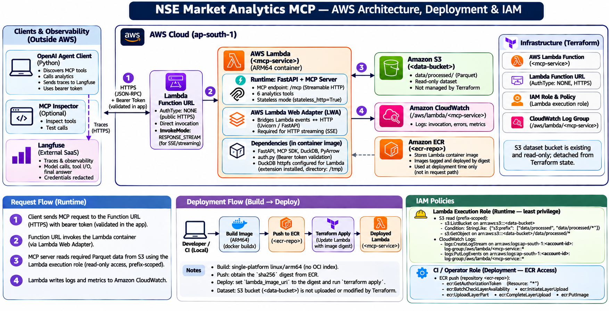
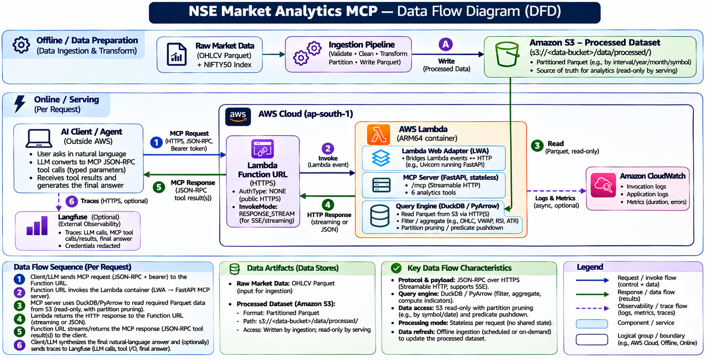

# Kite Market Data MCP

Explore NSE market data with a local analytics engine and an AI assistant that can discover and use its tools through the [Model Context Protocol (MCP)](https://modelcontextprotocol.io/). The project covers the path from raw market files to validated Parquet, time-aware analytics, and an optional AWS-hosted MCP endpoint.


## What you can do

- **Prepare a clean dataset:** validate raw OHLCV files against the NIFTY 50 symbol index and write partitioned Parquet for efficient queries.
- **Ask focused market questions:** retrieve candles, session statistics, price extremes, volume buckets, common indicators, and daily symbol comparisons.
- **Connect AI clients through MCP:** discover typed analytics tools at runtime over local stdio or Streamable HTTP, then answer questions with one or more tool calls.
- **Inspect the work:** optionally trace model and tool activity with Langfuse, and independently compare remote results with local calculations.
- **Run the service on AWS:** deploy the read-only analytics server as a Lambda container behind an authenticated Function URL, with Terraform-managed infrastructure and CloudWatch logs.

## Architecture

The local Python client discovers analytics tools over MCP. For remote use, an authenticated Lambda Function URL fronts a stateless Lambda service; Terraform manages the disposable service resources while the processed S3 dataset remains read-only.



## Data flow

Ingestion validates raw OHLCV files against the NIFTY 50 index and writes partitioned Parquet. DuckDB and PyArrow read only the needed partitions to answer typed MCP tool calls; the client turns tool results into a natural-language response. Optional traces and AWS logs support inspection.



The analytics layer uses predefined, parameterized queries. Timestamps are timezone-aware; trading dates and session buckets follow India time. Missing values remain explicit, and invalid inputs return stable errors. The same tools work against local files or the read-only S3 dataset.

## Try it locally

Install dependencies and process the raw files indexed by `data/index/NIFTY50.csv`:

```sh
uv sync
uv run python scripts/ingestion.py
```

Start the MCP server:

```sh
uv run uvicorn server.main:app --host 127.0.0.1 --port 8000
```

In another terminal, configure `OPENAI_API_KEY` in your environment and ask a question about a symbol and date present in your dataset:

```sh
uv run python -m client.main --server http://127.0.0.1:8000/mcp \
  --prompt 'Summarize RELIANCE on January 15, 2025, including open, close, return, VWAP, and number of bars.'
```

The client discovers the server's tools and schemas at runtime, validates model arguments, and executes the selected analytics calls. See the [tutorial](docs/tutorial.md) for analytics examples, MCP inspection, tracing, remote verification, and deployment workflows.

## Remote demo status

The disposable AWS Lambda endpoint is currently torn down. Local workflows remain available; restoring the remote demo requires AWS access and an explicitly reviewed Terraform plan. The existing processed S3 dataset is preserved. The tutorial describes restoration, independent result checks, CloudWatch inspection, and safe teardown.

## Documentation

- [Tutorial](docs/tutorial.md): run ingestion, analytics, the local MCP client, and optional remote workflows.
- [Remote demo](docs/demo.md): walk through the AWS-hosted MCP analytics flow and its verification steps.
- [Project documentation](docs/documentation.md): architecture, tool contracts, deployment boundaries, and verification evidence.
- [Feature records](docs/): retained requirements, plans, implementation journals, and focused feature tutorials.

## Development

Run the test suite with the project's Python environment:

```sh
uv run --no-project --with pytest --python .venv/bin/python -- python -m pytest tests/ -q
```
